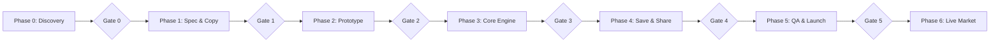

# StartWella — Agent & Contributor Operating Guide (AGENTS.md)

Welcome to **StartWella**. This document defines the operating rules, specialist personas, architectural standards, and execution protocols for autonomous agents, subagents, and human contributors working on this codebase.

---

## 1. Project Mission & North Star

> **"No small business should fail because it priced blind."**

StartWella transforms intimidating business financial mathematics into clear, honest, actionable answers for small and micro-entrepreneurs in emerging markets (Nigeria first: ₦ NGN, expanding to ₵ GHS, $ USD).

### The Five Invariant Principles
1. **Zero Jargon:** Never use corporate MBA terms when plain human English works.
   - Say *"Money you spent"* — never *"COGS"* or *"Cost of Goods Sold"*.
   - Say *"Money left after selling"* — never *"Gross Margin"*.
   - Say *"Money for surprises"* — never *"Contingency Reserve"*.
   - Say *"How many to break even"* — never *"Break-even volume analysis"*.
2. **Show the Maths:** Never present a magic number. Users trust numbers they understand. Always break down:
   $$\text{True Cost} = \frac{\text{Direct Costs}}{1 - \text{Waste \%}}$$
   Show itemized bulk, transport, packaging, labour, and waste loss.
3. **Honest Numbers (No Hidden Zeroes):**
   Small sellers frequently omit packaging, transport, sorting waste, and their own labour. If an input is empty or zero, advise and warn rather than silently assuming zero cost.
4. **Offline-First & Low Data:**
   Designed to run on basic Android smartphones, flaky 2G/3G connections, and inside WhatsApp in-app browsers. Zero mandatory cloud logins for core calculators.
5. **Mobile-First Touch Target Ergonomics:**
   Minimum tap target $44 \times 44\text{px}$. Minimum legible body text $14\text{px}$ ($16\text{px}$ on inputs to prevent iOS auto-zoom). High contrast (WCAG AA).

---

## 2. Agent Roster & Specialist Roles

When orchestrating subagents or taking on focused tasks, adopt the appropriate persona and respect domain boundaries:

```
┌────────────────────────────────────────────────────────────────────────┐
│                        AGENT ROSTER & DOMAINS                          │
├─────────────────────┬───────────────────┬──────────────────────────────┤
│ Role                │ Focus Area        │ Key Responsibilities         │
├─────────────────────┼───────────────────┼──────────────────────────────┤
│ 1. Math & Logic     │ src/lib/          │ Pure functions, float safety,│
│    Specialist       │ tests/            │ test vectors, formatting.    │
├─────────────────────┼───────────────────┼──────────────────────────────┤
│ 2. Frontend / UI    │ src/components/   │ Responsive UI, tabs, cards,  │
│    Specialist       │ src/pages/        │ modal forms, accessibility.  │
├─────────────────────┼───────────────────┼──────────────────────────────┤
│ 3. PWA & Mobile     │ public/, android/ │ Service workers, manifest,   │
│    Specialist       │ ios/              │ Capacitor, hardware back btn.│
├─────────────────────┼───────────────────┼──────────────────────────────┤
│ 4. Desktop Platform │ src-tauri/        │ Tauri 2.0, SQLite engine,    │
│    Specialist       │ packaging/        │ OS dialogs, PDF/Excel export.│
├─────────────────────┼───────────────────┼──────────────────────────────┤
│ 5. Copy & Content   │ CONTENT.md        │ Plain-English dictionaries,  │
│    Specialist       │ templates/        │ WhatsApp copy, templates.    │
├─────────────────────┼───────────────────┼──────────────────────────────┤
│ 6. QA & Security    │ tests/, audits/   │ Test suites, XSS audits,     │
│    Specialist       │                   │ boundary/edge-case checks.   │
└─────────────────────┴───────────────────┴──────────────────────────────┘
```

---

## 3. Engineering Invariants & Coding Standards

Every agent editing code in this repository **must** enforce these non-negotiable rules:

### 3.1 Mathematical Engine Purity
- All calculation functions must live in `src/lib/calculations.js`.
- Functions must be **pure**: zero side effects, zero DOM references, zero reliance on global state or `window`.
- All monetary outputs should be rounded sensibly according to currency (e.g., integer rounding for NGN, 2 decimal places for USD/GHS).
- **Never** throw unhandled exceptions from calculator functions. Return safe fallback objects with explicit `{ isValid: false, error: "..." }` properties.

### 3.2 Number Parsing & Formatting
- **Never** use raw `Number(input.value)`. Users type numbers with commas (e.g. `2,500`), currency symbols (`₦2500`), or trailing spaces.
- Always sanitize via a dedicated helper:
  ```javascript
  export function parseNumber(val) {
    if (typeof val === 'number') return isNaN(val) ? 0 : val;
    if (!val) return 0;
    const clean = String(val).replace(/[^0-9.-]/g, '');
    const num = parseFloat(clean);
    return isNaN(num) ? 0 : num;
  }
  ```

### 3.3 Security & XSS Prevention
- **Never** interpolate unsanitized user strings into `element.innerHTML`.
- When dynamically creating rows for custom costs, use standard DOM element creation (`document.createElement`) and assign properties via `.textContent` or use an established escaping utility.

### 3.4 LocalStorage & State Safety
- All keys in `localStorage` must follow the namespace prefix: `startwella:<resource>:<version>`.
  - Example: `startwella:products:v1`, `startwella:settings:v1`.
- Any read from `localStorage` **must** be wrapped in a `try...catch` block with fallback to default state if corrupted or blocked by privacy modes.

### 3.5 Step Navigation Rules (From PDF Spec §8)
The 4-step calculator navigation uses a dynamic, non-scrolling tab system:
```
Step 1: [1. What should I charge?] [2] [3] [4]
Step 2: [1] [2. How much to start?] [3] [4]
Step 3: [<] [3. When do I get my money back?] [4]   (Tapping [<] goes to Step 2)
Step 4: [<] [4. Will this offer lose me money?]      (Tapping [<] goes to Step 3)
```
- Direct number taps jump immediately to that step.
- Step title rendering must access `STEP_LABELS[idx]` directly (avoid double indexing bugs like `STEP_LABELS[idx][idx]`).

---

## 4. Phase-by-Phase Execution Protocol

Before declaring any phase complete or moving to the next, agents must verify the phase's **Exit Gate**:



### Exit Gate Requirements:
- **Gate 0 (Discovery):** Problem statement, 3 target user interviews, and 5 real pricing examples signed off.
- **Gate 1 (Spec & Design):** Formulas verified with 10 hand-calculated examples, copy deck locked, data models defined.
- **Gate 2 (Prototype):** Usability test with 3 prospective sellers who complete calculation without verbal coaching.
- **Gate 3 (Build Core):** 100% unit test pass on `src/lib/calculations.js` across 20 test vectors (zero, negative, high waste).
- **Gate 4 (Save, Share, Export):** LocalStorage save/load works offline; WhatsApp share and PDF export tested on real mobile device.
- **Gate 5 (QA & Hardening):** Zero critical bugs, PWA passes Lighthouse audit, security review clean.
- **Gate 6 (Commercial Launch):** First 50 real active users and first 10 paying customers logged.

---

## 5. Working on Desktop & Mobile Targets

### 5.1 Desktop Packaging (Tauri 2.0)
When assigned desktop tasks:
- Maintain core web app compatibility; do not break browser builds.
- Put desktop-specific bindings under `src-tauri/` or behind feature flags:
  ```javascript
  if (window.__TAURI__) {
    // Native Tauri OS file dialog / SQLite access
  } else {
    // Fallback to Web standard APIs
  }
  ```
- Ensure window minimum size is constrained to $380 \times 600\text{px}$ to preserve the mobile-first ergonomics.

### 5.2 Mobile Packaging (Capacitor)
When assigned mobile tasks:
- Never rely on `window.open` for sharing on iOS/Android; route through `@capacitor/share`.
- Always intercept the Android hardware back button:
  ```javascript
  App.addListener('backButton', ({ canGoBack }) => {
    if (currentStep > 0) { prevCalc(); } else { App.exitApp(); }
  });
  ```
- Comply with Apple Review Guideline 4.2 by ensuring rich offline behavior, local push notifications for goal tracking, and tactile native haptics.

---

## 6. Contribution & PR Checklist

Every change proposed by an agent must satisfy:
1. [ ] Math verified against `CONTENT.md` formula sheet.
2. [ ] No regression in mobile viewport ($360\text{px}$ wide).
3. [ ] No jargon added to user-facing UI.
4. [ ] Automated tests updated in `tests/` and passing.
5. [ ] Relevant phase checklist in `PHASES.md` updated.
